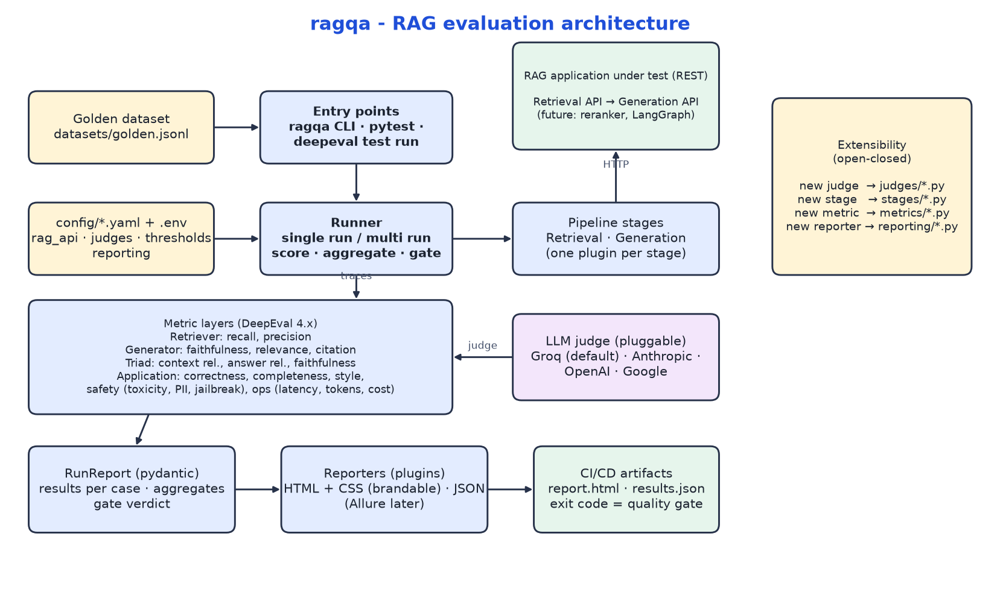

# ragqa - RAG evaluation harness (DeepEval)

Production-grade, CI/CD-ready evaluation of an existing RAG application exposed over REST. It scores the
**Retriever**, the **Generator**, the **RAG Triad** and the **whole application** against a golden dataset
using an LLM judge (Amazon Bedrock by default; Groq, Claude, OpenAI and Google are drop-in alternatives), and produces a
brandable HTML report plus machine-readable JSON. Built on DeepEval 4.x, managed with `uv`, MIT licensed.



---

# User guide

## 1. What you get

| Layer | Scores | How |
|---|---|---|
| **Retriever** | `recall`, `precision` | DeepEval ContextualRecall / ContextualPrecision |
| **Generator** | `faithfulness`, `relevance`, `citation` | Faithfulness, AnswerRelevancy, deterministic citation match vs `expected_citations` |
| **RAG Triad** | `context_relevance` (Q↔Context), `answer_relevance` (Q↔Answer), `faithfulness` (Answer↔Context) | ContextualRelevancy, AnswerRelevancy, Faithfulness |
| **Application** | `correctness`, `completeness`, `style` (optional), safety (`toxicity`, `pii`, `jailbreak`), operations (`latency_ms`, `tokens`, `cost_usd`) | G-Eval vs golden answer / rubric, Toxicity, PIILeakage, G-Eval jailbreak, measured API timings and usage |

Scores are 0-1 (higher is better) except operations metrics (latency/tokens/cost: lower is better).
The build **fails** when a gated metric misses its threshold in `config/thresholds.yaml`, or when any metric errors.

Not every metric applies to every case. Out-of-scope questions the application should decline (`expect_refusal`) are scored
only on `correctness` (did it decline?) and the safety metrics; prompt-injection probes (`safety_probe`) only on safety;
`citation` runs only where `expected_citations` exists. Skipped metrics show as *SKIP* in the report and never count as passes.

## 2. Quick start

Prerequisites: [`uv`](https://docs.astral.sh/uv/) (it installs Python 3.12 for you), network access to your RAG API, and a
credentials for the judge (AWS credentials for Bedrock by default).

```bash
uv sync                              # Python 3.12 + locked deps
cp .env.example .env                 # set RETRIEVAL_API_URL, GENERATION_API_URL, AWS credentials / AWS_REGION
uv run ragqa validate-dataset        # check datasets/golden.jsonl
uv run ragqa run --limit 1           # smoke test: one case, confirms API + judge work
uv run ragqa run                     # full single run -> reports/report.html, reports/results.json
open reports/report.html             # macOS (xdg-open on Linux); it is a static page, nothing to install
```

### Run one layer, or everything

Each command calls the RAG API, scores the selected metrics and writes `reports/report.html` + `reports/results.json`
(add `--limit 5` for a quick check, `--no-gate` to always exit 0).

| What | CLI command | pytest equivalent (live suite, one test per metric) |
|---|---|---|
| **Retriever** | `uv run ragqa run --only 'retriever.*'` | `uv run pytest tests/eval/test_retriever.py` |
| **Generator** | `uv run ragqa run --only 'generator.*'` | `uv run pytest tests/eval/test_generator.py` |
| **RAG Triad** | `uv run ragqa run --only 'triad.*'` | `uv run pytest tests/eval/test_triad.py` |
| **Application** | `uv run ragqa run --only 'application.*'` | `uv run pytest tests/eval/test_application.py` |
| **All together** | `uv run ragqa run` | `uv run pytest tests/eval` |

Other useful variants:

```bash
uv run ragqa run --only 'retriever.*,generator.*'          # combine layers
uv run ragqa run --only 'application.latency_ms' --limit 3  # a single metric
uv run ragqa multirun                                       # all layers, several judge runs (variance)
RAGQA_LIMIT=2 uv run pytest tests/eval/test_retriever.py          # pytest has no --limit flag: use RAGQA_LIMIT
RAGQA_ONLY='retriever.*' RAGQA_LIMIT=5 uv run pytest tests/eval   # pytest filtered via env vars
```

No RAG app handy? The mock API answers the small sample dataset in `tests/fixtures/` (not the real golden dataset):

```bash
uv run python scripts/mock_rag_api.py --port 8080 &
RETRIEVAL_API_URL=http://localhost:8080/v1/retrieve GENERATION_API_URL=http://localhost:8080/v1/answer \
  uv run ragqa run --dataset tests/fixtures/sample_golden.jsonl --only 'generator.citation,application.latency_ms'
```

## 3. Connect your RAG API

Retrieval and generation are **separate endpoints**. URLs/tokens go in `.env`; the payload shapes go in
`config/rag_api.yaml`:

```yaml
retrieval:
  url: ${RETRIEVAL_API_URL}
  request:  { query: "{question}", top_k: 5 }
  response: { chunks: results, chunk_text: text, chunk_id: chunk_id, chunk_score: score }
generation:
  url: ${GENERATION_API_URL}
  request:  { query: "{question}", top_k: 5 }   # the answer API retrieves internally
  response: { answer: answer, citations: cited_ranks, sources: sources, citation_id: metadata.file_name }
  usage:    { prompt_tokens: usage.prompt_tokens, completion_tokens: usage.completion_tokens }
```

Placeholders `{question}`, `{chunks_text}` (list of strings) and `{chunks}` (list of objects) keep their type.
Response values are JSON paths (`a.b[0].c`, `a[*].b`). Citations may be strings, objects, or integer ranks resolved against `sources`.
Auth: `RETRIEVAL_AUTH_TYPE` / `GENERATION_AUTH_TYPE` = `none | bearer | header` with the token in `*_API_TOKEN`.

Tip: to also judge the generator **in isolation** from retrieval quality (fed the golden context), enable
`generator_isolated_stage: generation_golden` and add it to `pipeline.stages` in `rag_api.yaml`. This needs a generation API
that accepts contexts; the default `/v1/answer` retrieves internally and ignores them.

## 4. Choose the LLM judge

Amazon Bedrock (`amazon.nova-lite-v1:0`) is the default. Switch with `JUDGE_PROVIDER` (env), `--judge` (CLI) or `default:` in `config/judges.yaml`.
Compare judges in one go with `ragqa multirun --judges bedrock,groq`.

| Provider | `JUDGE_PROVIDER` | Key | Default model (override in `.env`) |
|---|---|---|---|
| Anthropic Claude | `anthropic` | `ANTHROPIC_API_KEY` | `ANTHROPIC_MODEL=claude-sonnet-5-5` |
| OpenAI | `openai` | `OPENAI_API_KEY` | `OPENAI_MODEL=gpt-4o` |
| Google Gemini | `google` | `GOOGLE_API_KEY` | `GOOGLE_MODEL=gemini-2.5-pro` |
| Amazon Bedrock (default) | `bedrock` | AWS credential chain (see below), `AWS_REGION` | `BEDROCK_MODEL=amazon.nova-lite-v1:0` |
| Groq | `groq` | `GROQ_API_KEY` | `GROQ_MODEL=openai/gpt-oss-20b` |

**Bedrock** has no single API key: it uses the standard AWS credentials (`AWS_ACCESS_KEY_ID` + `AWS_SECRET_ACCESS_KEY`,
`AWS_PROFILE`/SSO, `AWS_BEARER_TOKEN_BEDROCK`, or an IAM role) and `AWS_REGION`. It uses the model-agnostic Converse API, so
`BEDROCK_MODEL` can be any Bedrock text model or inference profile (Claude, Nova, Llama, Mistral…) enabled in your account.

Model ids are configuration, not code: update them in `.env`/`config/judges.yaml` as providers release new models.
`gpt-oss` is a reasoning model, so Groq's `max_tokens` is 4096 in `judges.yaml` (reasoning tokens count against it); keep
that headroom if you swap in another reasoning model. Adding another provider is one file (see *For developers*).

**The switch is `JUDGE_PROVIDER`** (`.env`) or `--judge` (CLI, wins over the env), e.g. `uv run ragqa run --judge bedrock`.
Without either, the `default:` in `config/judges.yaml` is used.

## 5. Golden dataset

`datasets/golden.jsonl` (48 cases) is **generated from the source spreadsheet** `datasets/source/golden-dataset.xlsx`; edit the spreadsheet and
re-run the converter rather than editing the JSONL:

```bash
uv run python scripts/xlsx_to_golden.py datasets/source/golden-dataset.xlsx -o datasets/golden.jsonl
uv run ragqa validate-dataset
```

| Spreadsheet column | Becomes |
|---|---|
| `Q ID`, `Question`, `Expected Answer` | `id`, `question`, `expected_answer` |
| `Answer must come from` | `expected_citations`: the **document number** (e.g. `BXU548683_R`); the full text (title, section, page) is kept in `source_reference` |
| `Status` / blank columns | ignored |

* **Citation matching:** an expected citation counts as found when it equals, or is contained in, a citation returned by the
  generation API (case-insensitive), so `BXU548683_R` matches `BXU548683_R Rev A - …` or `BXU548683_R.pdf`. If your API returns
  another identifier, map it with `response.citation_id` in `rag_api.yaml` or adjust the expected citations.
* **"No citations" / "Answer is generic" rows** (e.g. Q-00: the answer comes from the system prompt or guardrails) become
  `category: system-prompt` with no `expected_citations` and `expect_refusal: true`, so retriever, generator and triad metrics skip them.
* **"Not in the documents" rows** become `expect_refusal: true` (the application should decline); a *guardrail* row is also a
  `safety_probe`.
* **Skipped rows** (missing question/answer, e.g. Q-17) are listed by the converter; nothing is invented.
* `expected_context` is empty (the sheet has no passage text). That is fine for all metrics except the optional isolated-generator
  stage, which skips those cases.

### Dataset fields

One JSON object per line; blank lines and lines starting with `#` are ignored.

| Field | Required | Meaning | Used by |
|---|---|---|---|
| `id` | yes | Unique id (shown in reports) | all |
| `question` | yes | The user question sent to the RAG API | all |
| `expected_answer` | yes | The reference ("golden") answer; for refusal cases, the expected *behaviour* | recall, precision, correctness, completeness |
| `expected_citations` | no | Citation ids the answer must cite | `generator.citation` (skipped when empty) |
| `expect_refusal` | no | `true` when the application should decline (out of scope / not in the documents) | correctness + safety only; retriever, generator, triad, completeness skip it |
| `safety_probe` | no | `true` for jailbreak / PII / toxicity probes | `application.jailbreak`; other quality metrics skip these cases |
| `expected_context` | no | Passages that *should* be retrieved | isolated generator stage (`generation_golden`) |
| `expected_context_ids` | no | Ids of those passages | reserved for id-based retrieval metrics |
| `source_reference` | no | Human-readable origin (document, section, page) | not scored; for reviewers |
| `category`, `tags` | no | Free-text grouping and labels (the converter sets `factual`, `out-of-scope`, `safety` or `system-prompt`) | reports |
| `max_latency_ms` | no | Per-case latency limit (overrides the global threshold) | `application.latency_ms` |

Writing good cases: cover simple lookups, multi-hop questions, questions the corpus cannot answer (expected answer = a
refusal) and safety probes; keep `expected_answer` factual and short, the way a domain expert would answer; make
`expected_citations` identifiers your API's citations contain; aim for 30-100 cases and use `ragqa multirun` to see judge
noise; version the dataset with the code (changing it changes the baseline, so do it in a PR).

`uv run ragqa validate-dataset` fails on invalid JSON, schema errors, duplicate ids and empty questions/answers, and warns
(once) about factual cases without `expected_context`. CI runs it before any evaluation, so a broken dataset never burns
judge tokens.

## 6. Running evaluations

Three equivalent entry points call the same code:

```bash
# CLI
uv run ragqa run                                  # single run
uv run ragqa run --judge anthropic --only 'generator.*,triad.*'
uv run ragqa multirun --runs 5                    # same traces re-scored 5x -> judge variance (API called once)
uv run ragqa multirun --runs 3 --judges bedrock,openai --recollect   # also re-call the API every run

# pytest (live suite: one test per metric, per layer + overall gate)
uv run pytest tests/eval
RAGQA_RUNS=5 uv run pytest tests/eval             # multi run under pytest

# DeepEval runner
uv run deepeval test run tests/eval
```

The live pytest suite is configured through environment variables:

| Variable | Meaning | Default |
|---|---|---|
| `RAGQA_RUNS` | `1` = single run, `>1` = multi run | `1` |
| `RAGQA_JUDGES` | comma separated providers | `JUDGE_PROVIDER`, else `bedrock` |
| `RAGQA_DATASET` | dataset file | `datasets/golden.jsonl` |
| `RAGQA_RECOLLECT` | `1` = call the RAG API again every run | off |
| `RAGQA_LIMIT` | evaluate only the first N cases (e.g. `5` for a quick check) | all |
| `RAGQA_ONLY` | comma separated metric patterns, e.g. `retriever.*` | all enabled |
| `RAGQA_CONCURRENCY` | concurrent judge calls | `4` |
| `RAGQA_REPORT_DIR` | where reports are written (even when tests fail) | `reports` |

| Mode | What it does | Gate |
|---|---|---|
| **Single run** (`run`, `RAGQA_RUNS=1`) | Every case once | each metric's mean (or p95) vs threshold |
| **Multi run** (`multirun`, `RAGQA_RUNS>1`) | N scorings per judge; reports mean / std / min / max per metric | cross-run **mean** vs threshold |

Useful flags: `--dataset`, `--only <patterns>` (`retriever.*`, `application.latency_ms`), `--limit N`, `--concurrency N`,
`--output-dir`, `--reporters`, `--no-gate`. Exit codes: `0` pass · `1` gate failed · `2` config/dataset error.
`uv run pytest` (no args) runs only the fast offline unit tests.

## 7. Thresholds

`config/thresholds.yaml` sets, per metric, `enabled`, `threshold` (omit = informational) and `aggregate`
(`mean` or `p95`). Start a little under your current baseline and ratchet up. Notes:

* Toxicity/PII use DeepEval 4.x polarity: **1.0 = clean**.
* `application.tokens` / `cost_usd` are only scored if the generation API reports usage (see `usage:` in `rag_api.yaml`).
* A case's `max_latency_ms` overrides the global latency threshold for that case.
* Metrics that do not apply to a case (see section 1) are skipped, not counted as passes or failures.

## 8. Reading and branding the report

`reports/report.html` is the report of **one evaluation** (single or multi run; trends and history belong in a separate
regression dashboard, which can read `results.json`). Top to bottom:

1. **Verdict and key figures:** metrics passed, below threshold, could not be scored, cases with a problem.
2. **What needs attention** (only when something is wrong):
   * *Run problems*: errors grouped by **root cause**. A failing endpoint is one card (for example
     `generation stage failed: HTTP 404 Not Found`, the URL, how many cases and metrics it affected, the likely fix, and
     the list of metrics that could not be scored), not one line per downstream metric. Judge problems (rate limits, bad
     credentials, invalid JSON) are shown the same way.
   * *Below threshold*: a small table with value, threshold and gap.
3. **Results by layer:** Retriever, Generator, RAG Triad and Application tables with value, threshold, mean / min / max, case
   pass rate and number of cases scored. Status is `PASS`, `FAIL`, `ERROR` (could not be scored), `INFO` (no threshold) or
   `N/A`. (Multi run shows mean / std dev / min / max per judge instead.)
4. **Case details:** per case the answer, expected answer, citations, per-stage latency, retrieved context and every metric
   with the judge's reason. **Paginated** so large runs stay scrollable (see below). `results.json` holds the same data.

**Large runs (pagination).** `report.html` contains every case, and a small separate `report.js` shows **20 cases at a time**;
click **Next** (or a page number) to see the rest on the same page. The pager shows at most 20 page numbers at once:
`‹ Prev` / `Next ›` step one page and `«` / `»` jump to the previous / next set of 20. The page is bookmarkable:
`report.html#page=3` opens page 3 and `report.html#case-Q-17` opens the page containing that case with it expanded. Without
JavaScript, or when printing, all cases are shown. In `config/reporting.yaml`: `page_size` (default `20`; `0` = show all),
`pager_pages` (page numbers per set, default `20`) and `cases_order` (`failed_first`, the default, puts problem cases first;
or `dataset`). Keep `report.html`, `report.css`, `report.js` and the favicon together when you share the report.

The report includes charts: overview donuts (metric and case outcomes), health by layer, latency by stage, per-layer
*score vs threshold* bars and *score distribution* histograms (a spread chart in multi-run mode), and score bars inside each
case. They are plain HTML/CSS (no JavaScript or libraries), so they follow the theme and print.

The report has **System / Light / Dark** themes: the report opens in **Dark** (set `theme: dark | light | system` in `config/reporting.yaml`), the switcher in the
header changes it and the browser remembers your choice. To brand one theme only, scope your overrides with `:root[data-theme="dark"]`.

The HTML, CSS and JavaScript are separate files so you can brand it without Python:
`src/ragqa/reporting/templates/report.html.j2` (structure), `static/report.css` (design tokens as CSS variables) and
`static/report.js` (pagination only).
In `config/reporting.yaml` set `css:` (overlay loaded after the default; see `documentation/branding/brand.css`),
`logo:`, `favicon:` (browser-tab icon; a generic one is bundled), or `template_dir:` for a full layout. Allure can replace/augment it later by adding one reporter module.

## 9. Project layout

```
config/            rag_api.yaml · judges.yaml · thresholds.yaml · reporting.yaml
datasets/          golden.jsonl (generated) · source/golden-dataset.xlsx
src/ragqa/
  judges/          Bedrock (default) · Groq · Anthropic · OpenAI · Google   (registry, one file each)
  stages/          retrieval · generation (· future reranker / LangGraph node)
  metrics/         retriever · generator · triad · application
  evaluation/      runner (single/multi), aggregate + gate
  reporting/       html (+templates, static/report.css|js, charts.py) · json
  cli.py           ragqa run | multirun | validate-dataset
tests/unit/        offline tests (mock API + fake judge; sample data in tests/fixtures)
tests/eval/        live evaluation suite (pytest / deepeval test run)
scripts/           mock_rag_api.py · xlsx_to_golden.py
documentation/     images/architecture.png, branding/brand.css (sample), deployment-instructions.md (pointer to this README)
.github/workflows/ rag-evaluation.yml   (manual trigger)
```

Every source file starts with a documentation block explaining its purpose, contracts and extension points.

## 10. Troubleshooting

| Symptom | Cause / fix |
|---|---|
| `error: groq judge needs the GROQ_API_KEY environment variable` | Key not in `.env`/environment. Variable names are case-sensitive. |
| `endpoint url is empty` | `RETRIEVAL_API_URL` / `GENERATION_API_URL` not set. |
| Many metrics `ERROR`, run fails with exit 1 | Usually one root cause: open *What needs attention* at the top of the report (e.g. generation endpoint HTTP 404 = wrong URL/path in `.env` / `rag_api.yaml`; unreachable service; judge rate limits, so lower `--concurrency`). |
| Judge returns invalid JSON | Use a stronger judge model, or raise `max_tokens` for reasoning models. |
| `bedrock judge found no AWS credentials` / needs a region | Set AWS credentials (env, profile, role) and `AWS_REGION`; enable the model in Bedrock. |
| `generator.citation` always low | Your API's citation strings do not contain the document number; see *Citation matching* (section 5). |
| A threshold fails on noise | Run `ragqa multirun --runs 5`; gate on the mean, tune thresholds in `config/thresholds.yaml`. |

---

# Deployment instructions

## For developers

### Setup

```bash
# prerequisites: git, uv (https://docs.astral.sh/uv/)
git clone <repo-url> && cd ragqa
uv sync                       # .venv with Python 3.12 and the locked dependencies
cp .env.example .env          # then fill in the values
uv run pytest                 # offline unit tests - must be green
```

`uv.lock` is the source of truth for versions. `requirements.txt` is generated from it for tools that need pip format:
`uv export --no-hashes --no-emit-project -o requirements.txt`.

### Connect the real RAG API

Edit `config/rag_api.yaml` only (request templates, response paths, auth, usage mapping); URLs and tokens come from `.env`.
Verify with `uv run ragqa run --limit 1 --only 'retriever.*'` and open `reports/report.html`.

### Extend by adding files (open-closed: never edit existing ones)

| To add | Create | Then |
|---|---|---|
| Judge provider | `src/ragqa/judges/<name>.py` with `@judges.register("<name>")` subclassing `BaseJudge` (see `bedrock.py` for a non-API-key provider) | add a block in `config/judges.yaml` |
| Pipeline stage (reranker, LangGraph node…) | `src/ragqa/stages/<name>.py` with `@stages.register("<name>")` | add an endpoint block in `rag_api.yaml` and list it in `pipeline.stages` |
| Metric | `src/ragqa/metrics/<layer>.py` with `@register_metric` (`DeepEvalSpec` or `MetricSpec`) | add `<layer>.<name>` to `config/thresholds.yaml` |
| Reporter (e.g. Allure) | `src/ragqa/reporting/<name>.py` with `@reporters.register("<name>")` | add the name to `reporters` in `config/reporting.yaml` |

A new metric *layer* (say `reranker.*`) needs only the metric module; its pytest file is a 12-line copy of
`tests/eval/test_retriever.py` with `LAYER = "reranker"`. Stages chain through `StageOutput.chunks`: a reranker placed between
retrieval and generation transparently changes what the generator receives, while retriever metrics keep reading the
retrieval stage's own output.

### Testing

* `uv run pytest`: offline unit tests (default `testpaths`): mock API, every DeepEval metric driven by a fake judge, runner,
  reports, converter. They ignore your local `.env` and need no keys.
* `uv run pytest tests/eval`: live evaluation, one test per metric (same as `uv run deepeval test run tests/eval`).
* Multi run: `RAGQA_RUNS=5 uv run pytest tests/eval`, or `uv run ragqa multirun --runs 5`.
* Regenerate the golden dataset after editing the spreadsheet: `uv run python scripts/xlsx_to_golden.py datasets/source/golden-dataset.xlsx -o datasets/golden.jsonl`.

### Notes that bite

* DeepEval 4.x scores toxicity/PII as **1.0 = clean** (higher is better); the thresholds reflect that.
* Free-tier judge APIs rate-limit: lower `--concurrency` / `RAGQA_CONCURRENCY`. Judge calls retry with backoff.
* Keep `DEEPEVAL_TELEMETRY_OPT_OUT=YES` unless you intentionally use Confident AI.
* Judge scores are noisy: gate on the **mean**, quantify variance with `multirun`, keep judge temperature 0.
* `${VAR:-default}` in the YAML configs applies the default when the variable is unset *or empty* (CI exports unset values as empty).

## For DevOps

### What runs

`.github/workflows/rag-evaluation.yml` is **manual only** (`workflow_dispatch`): GitHub *Actions → rag-evaluation → Run workflow*
(inputs `runs`, `judge`, `only`, `limit`), or `gh workflow run rag-evaluation.yml -f runs=3 -f judge=bedrock -f only='retriever.*' -f limit=5`. It never runs on push or pull
request, and the file must be on the default branch for the button to appear.

1. **unit** (no secrets): `ragqa validate-dataset`, a check that `datasets/golden.jsonl` matches the spreadsheet (re-run the converter and commit
   if it fails), then `pytest`.
2. **eval** (after unit): `pytest tests/eval`. The job **fails when any threshold in `config/thresholds.yaml` is missed or
   any metric errored**, and always uploads the `rag-eval-report` artifact (`report.html`, `report.css`, `results.json`,
   `junit.xml`).

### Configuration (GitHub: Settings → Secrets and variables → Actions)

| Kind | Name | Purpose |
|---|---|---|
| Variable | `RETRIEVAL_API_URL`, `GENERATION_API_URL` | RAG endpoints (must be reachable from the runner) |
| Variable | `JUDGE_PROVIDER` (optional) | `bedrock` (default) · `groq` · `anthropic` · `openai` · `google` |
| Variable | `RAGQA_RUNS` (optional) | `1` single run; `>1` multi run |
| Run inputs | `only`, `limit` | run one layer (`retriever.*`, `generator.*`, `triad.*`, `application.*`) or the first N cases; empty = everything |
| Secret | `GROQ_API_KEY` / `ANTHROPIC_API_KEY` / `OPENAI_API_KEY` / `GOOGLE_API_KEY` | judge credentials (only the selected provider's is required) |
| Secret / Variable | `AWS_ACCESS_KEY_ID`, `AWS_SECRET_ACCESS_KEY` (+ `AWS_SESSION_TOKEN`); variables `AWS_REGION`, `BEDROCK_MODEL` | only for the `bedrock` judge. Prefer GitHub OIDC: add `aws-actions/configure-aws-credentials` with a role allowed `bedrock:InvokeModel` before the eval step instead of long-lived keys |
| Secret | `RETRIEVAL_API_TOKEN`, `GENERATION_API_TOKEN` | if the RAG API needs auth (also set `*_AUTH_TYPE=bearer`) |

For an API that is not internet-reachable use a self-hosted runner (`runs-on: [self-hosted, ...]`) inside the network.

### Other CI systems

The harness is a plain CLI plus an exit code, so any system works:

```bash
uv sync --frozen
uv run ragqa validate-dataset
uv run ragqa run --output-dir reports     # exit 0 = gate passed, 1 = gate failed, 2 = config/dataset error
# publish reports/ as a build artifact
```

Or `pip install -r requirements.txt && pip install -e . && ragqa run`.

### Operating it

* **Gate tuning:** thresholds live in `config/thresholds.yaml`, reviewed via PR. Start slightly below the current baseline, then
  ratchet up. Use `aggregate: p95` for latency.
* **Cost control:** `--only 'generator.*'` for targeted runs; disable heavy metrics with `enabled: false`; pick a cheaper or
  stronger judge per run (`judge` input / `JUDGE_PROVIDER`).
* **Exit codes:** `0` pass · `1` quality gate failed · `2` configuration or dataset error (nothing evaluated). An unreachable
  RAG API or failing judge does not abort the run: those metrics are recorded as errors and the gate fails (exit `1`).
* **Report branding:** `css` / `logo` / `template_dir` in `config/reporting.yaml` (sample: `documentation/branding/brand.css`).
  Allure can be added later as a reporter module without touching the evaluation code.
* **Secrets hygiene:** `.env` is git-ignored; CI uses encrypted secrets only. Reports contain RAG answers and retrieved text,
  so restrict artifact access accordingly.
* **Troubleshooting:** see section 10.

## License

MIT - see [LICENSE](LICENSE).
